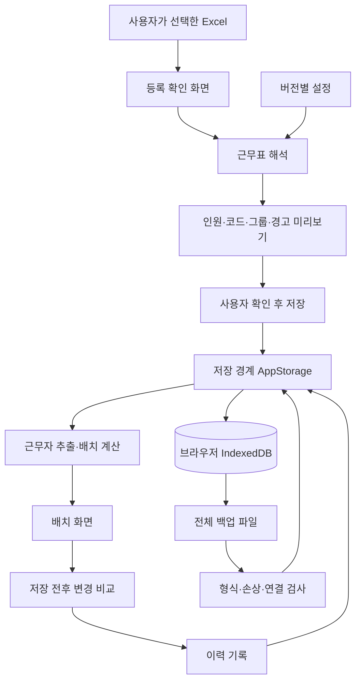

# 구조와 변경 방법 — v0.7.3

현재 앱은 서버 없이 브라우저에서 계산·저장하는 단일 사용자 도구입니다. 이번 리팩터링은 기존 결과를 유지하면서 계산을 화면에서 떼어내는 작업입니다. 프레임워크나 서버를 새로 도입하지 않았습니다.

## 책임을 나눈 구조



**경계**는 서로 다른 책임이 만나는 접점입니다. `AppStorage`라는 저장 경계를 통해 호출하면, 화면이 DB 내부 구조를 직접 다룰 필요가 줄어듭니다. 병원 서버를 붙일 때도 같은 목적의 API로 교체할 위치가 분명해집니다. 다만 현재 저장 인터페이스를 HTTP로 바꾸는 것만으로 서버 시스템이 완성되지는 않습니다.

**도메인**은 프로그램이 다루는 업무 규칙입니다. 이 앱에서는 근무 코드 해석, 선임 순서와 반 편성이 해당합니다. `domain/` 계산은 브라우저 화면과 저장소를 직접 읽지 않습니다. 필요한 근무표·인원·날짜·듀티를 함수 인자로 받습니다.

**순수 함수**는 같은 입력에 같은 결과를 내고 외부 상태를 바꾸지 않는 함수입니다. 예를 들어 `automaticGroups(staff, roster)`는 주어진 근무자를 반별로 나눕니다. 화면을 띄우지 않고도 이전 결과와 비교할 수 있습니다.

**어댑터**는 바깥 형식을 내부 형식으로 연결하는 코드입니다. `ui/import-review.js`가 Excel 파일을 셀 배열로 바꾸고, `roster-parser.js`는 그 배열만 해석합니다. Excel 라이브러리나 파일 선택 방식을 바꾸더라도 배치 계산을 함께 고칠 이유가 줄어듭니다.

## 무엇을 바꾸려면 어디를 고치는가

| 변경 요구 | 먼저 볼 파일 | 주의할 점 |
| --- | --- | --- |
| 날짜 행·이름 열이 다른 근무표 | `domain/config.js`의 parserProfiles | 미리보기에서도 행·열을 지정할 수 있습니다. UI 행 번호는 1부터, 설정 인덱스는 0부터 셉니다. |
| 선임 그룹 인원 구간 | parserProfiles.groupBands | 마지막 구간의 count는 null이며 나머지 인원을 뜻합니다. 행 순서 기준이라는 가정은 유지합니다. |
| 새로운 근무 코드 | ruleProfiles.dutyCodes | 코드가 D/E/N 중 어느 듀티를 의미하는지 먼저 확인합니다. |
| 반별 간호사 수 | notificationCount, fireCount | 남은 간호사와 사원·의사는 대피유도반입니다. 세 반보다 더 복잡한 역할 구조는 계산 함수 변경도 필요합니다. |
| 선임 그룹 명칭·순서 | groupOrder와 groupBands | 두 설정의 그룹 명칭을 맞춥니다. 인원 관리의 선택지도 해당 근무표 규칙에서 생성합니다. |
| 듀티 자동 전환 시각 | dutyStarts | 자정부터 지난 분입니다. D/E/N 순서가 증가해야 합니다. 07:30은 450입니다. |
| 화면에 표시할 근무 시간 | dutyDisplay | 기존 표시 시간은 인수인계를 포함합니다. 자동 전환 시각과 별개이므로 함께 검토합니다. |
| 병원 API 저장 | `storage.js` | 인증, 권한, 동시 편집, 장애 처리, 서버 이력 정책을 먼저 설계합니다. |
| 수정 이력 항목 | `domain/change-events.js`, `audit.js` | 메뉴 열기 같은 단순 UI 동작은 기록하지 않습니다. |
| 백업 형식 변경 | `domain/backup-format.js` | formatVersion을 올리고 이전 파일을 읽는 명시적인 변환을 추가합니다. |

## 기존 근무표가 바뀌지 않게 새 규칙 추가하기

**프로필**은 설정값을 이름 하나로 묶은 것입니다. **스냅샷**은 특정 시점의 복사본입니다. 새로 저장한 근무표에는 `ruleSnapshot`에 규칙 복사본을, `parserSnapshot`에 당시 해석 설정을 보관합니다.

1. `micu-v1`을 그대로 보존하고 `micu-v2`라는 새 프로필을 만듭니다.
2. 필요한 값만 바꾸고 `activeRuleId`를 새 ID로 지정합니다. 양식이 달라지면 parserProfiles에도 새 ID를 만들고 activeParserId를 바꿉니다.
3. 새 파일을 미리보기에서 확인하고 저장합니다. 이미 저장한 근무표의 ruleSnapshot은 바뀌지 않습니다.
4. 기존 근무표에도 새 규칙을 적용하려면 해당 월을 다시 등록·교체해야 합니다. 교체는 해당 월의 인원 변경·수동 배치를 초기화하므로 먼저 전체 백업을 보관합니다.

아래는 구조를 설명하기 위한 예시이며 실제 MICU 운영 변경안이 아닙니다.

```js
const ruleProfiles = {
  'micu-v1': { /* 기존 설정을 그대로 유지 */ },
  'micu-v2': {
    // micu-v1의 전체 설정을 복사하고 ID·확인된 값만 변경
    id: 'micu-v2',
    label: '검토 완료한 새 규칙',
    dutyCodes: {D:'D', E:'E', N:'N', NC:'N'},
    groupOrder: ['Charge', '중간년차', '저연차'],
    roles: {notification:'통보연락반', fire:'소화반', evacuation:'대피유도반'},
    notificationCount: 2,
    fireCount: 1,
    dutyDisplay: {D:'07:00–15:30', E:'15:00–22:30', N:'22:00–07:30'},
    dutyStarts: {D:450, E:900, N:1320}
  }
};
```

v0.7.2 이전 데이터에는 규칙 스냅샷이 없습니다. 이 데이터는 `legacyRuleId: 'micu-v1'`로 해석합니다. 따라서 기존 micu-v1과 legacyRuleId를 수정하면 과거 결과가 달라질 수 있습니다. 새 프로필을 추가하는 원칙이 필요한 이유입니다.

## 인원 ID와 원본 보존

**ID**는 같은 이름을 가진 사람도 구분하는 내부 표식입니다. 원본 인원은 `source:근무표ID:행순서`, 추가 인원은 `added:임의ID`를 씁니다. 이름을 수정해도 ID는 그대로 유지합니다.

이 ID는 현재 브라우저 근무표 안의 식별자입니다. 병원 직원번호가 아니며, 근무표를 새 파일로 교체했을 때 같은 실제 사람이라고 자동으로 연결하지 않습니다. 새 양식의 사번을 도입하려면 인원 연결과 기존 수정사항 이전 방식을 별도로 설계해야 합니다.

원본 인원을 삭제하면 Excel 자체가 아니라 해당 날짜·듀티의 제외 목록을 수정합니다. 원본 근무표·프로필 변경·추가/제외 인원·수동 배치를 분리한 이유입니다.

## 백업이 저장 안정성에 추가하는 것

**원자성**은 묶인 변경이 모두 적용되거나 모두 취소되는 성질입니다. 전체 복원은 다섯 저장 영역을 한 IndexedDB 트랜잭션으로 바꿉니다. 중간 쓰기 실패를 주입한 자동검사에서 이전 데이터가 유지됐습니다.

**변경 번호(revision)**는 오래된 화면이 최신 데이터를 덮어쓰지 않도록 비교하는 숫자입니다. 전체 복원에는 별도 세대 번호(storageEpoch)를 추가했습니다. 복원 전에 열린 창은 예전 세대이므로 새로고침 전 쓰기를 거절합니다. 복원 전에 내려받은 현재 백업 이후 다른 창이 변경한 경우도 복원을 중단합니다.

저장이 끝났더라도 곧바로 성공이라고 말하지 않고 다시 읽어 비교합니다. 다만 쓰기는 끝났는데 재읽기만 실패했다면 이미 바뀐 데이터일 수 있습니다. 이 경우 기존 상태가 유지됐다고 주장하지 않고 확인 필요 상태를 표시합니다.

백업은 파일 복구 수단이며 실시간 동기화가 아닙니다. 이력은 변경 설명이며 백업을 대신하지 않습니다. 백업 검증값은 우발적 파일 손상을 찾지만, 내용을 바꾸고 검증값을 다시 계산한 사람을 인증하지는 못합니다.

## 구조 평가와 남은 한계

이번 구조는 규칙을 시험하고 파일 양식을 교체하기 쉬워졌습니다. 가상 근무표 90개 문맥과 제공 파일의 180개 문맥을 이전 배치 결과와 비교해 동일함을 확인했습니다. 문맥은 특정 날짜와 듀티의 조합입니다.

화면 상태는 여전히 `script.js`의 변수로 관리하고 기존 HTML을 직접 갱신합니다. 파일만 늘린 전면 재작성 대신, 위험도가 높은 해석·계산·백업 부분부터 분리했습니다. 다음 단계에서 화면 변경이 잦아지면 선택 상태와 저장 작업을 묶은 작은 상태 관리 모듈로 분리할 수 있습니다.

현재 프로토타입에는 인증·권한·공유 DB·중앙 감사로그가 없습니다. 서버 전환 시 사용자별 접근, 변경 충돌, 서버 기준 시각과 로그, 개인정보 정책, 장애 시 읽기 전용 운영 방식을 별도 검토해야 합니다. 현재 브라우저 로그는 병원 공식 감사로그로 평가하지 않습니다.

실제 휴대폰과 Windows Google Chrome 검증이 남아 있으며, 현재 자료도 공식 UM 양식으로 확정하지 않았습니다. 사용자 요청에 따라 기존 파일·현재 규칙을 기준으로 작업했고, 실제 양식과 승인 규칙을 받으면 프로필과 검증 사례를 추가할 수 있도록 준비했습니다.
