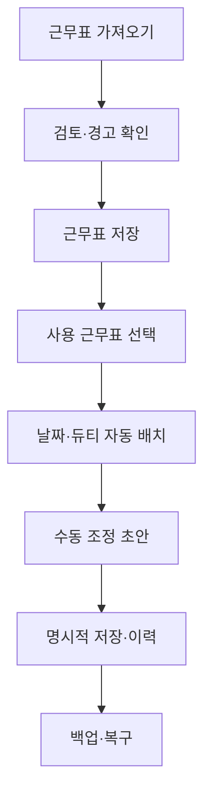

# MICU 화재대피 인원배치 개발 지침과 로드맵

문서 상태: v0.7.4 RC 이후 공식 개발 방향  
기준일: 2026-10-09  
적용 범위: 기능 기획, 구조 변경, 검증, 배포 판단

## 1. 제품 목적과 개발 우선순위

이 앱은 화재 상황을 대신 판단하는 시스템이 아니라, 선택한 날짜와 듀티의 근무자를 확인된 규칙으로 배치하고 현장 판단에 따라 수정·저장·복구하도록 지원하는 업무 도구다.

개발 우선순위는 다음 순서를 유지한다.

1. 배치 결과의 정확성
2. 데이터 보존, 충돌 방지와 복구 가능성
3. 모바일을 포함한 현장 사용성
4. 운영·업데이트·백업 관리
5. 여러 기기와 사용자 사이의 공유
6. 업무 범위 확장

기능 수나 화면의 화려함보다 정확성, 설명 가능성, 명시적 저장, 되돌릴 수 있는 변경을 우선한다. 실제 MICU 규칙과 공식 자료로 확인하지 않은 내용을 운영 사실로 확정하지 않는다.

## 2. 현재 기준과 보호할 구조

v0.7.4 RC는 서버 없이 브라우저와 IndexedDB에서 동작하는 로컬 우선 앱이다. 다음 계약을 이후 버전에서도 보호한다.

- 근무표 선택·검토·저장과 실제 사용 근무표 선택을 분리한다.
- D/E/N과 NC=N, 야간 날짜 경계, 선임순 역할 배치 결과를 임의로 변경하지 않는다.
- 자동 계산 결과와 수동 override를 분리하고 수동 변경을 우선한다.
- 인원 추가·제외·이름·그룹 변경은 원본 근무표와 분리한다.
- 역할 초기화와 전체 초기화를 구분하며, 저장하지 않은 초안을 보존하거나 명시적으로 취소한다.
- 저장은 revision과 storage epoch를 이용해 오래된 탭의 덮어쓰기를 차단한다.
- 규칙과 parser 설정은 버전별 프로필과 근무표 snapshot으로 보존한다.
- 백업은 복구 수단이며 실시간 동기화나 공식 감사로그로 간주하지 않는다.

현재 `domain/`의 계산 책임, `storage.js`의 저장 경계, 버전형 규칙 프로필은 유지한다. 코드가 길다는 이유만으로 프레임워크 전환이나 전면 재작성을 하지 않는다.

## 3. 목표 업무 흐름

화면은 최소한 다음 상태를 사용자가 구분할 수 있게 해야 한다.

- 저장되지 않은 가져오기 검토
- 저장되었지만 현재 사용하지 않는 근무표
- 현재 사용 중인 근무표
- 저장되지 않은 인원 또는 배치 수정
- 저장 완료
- 충돌로 저장이 중단된 상태
- 저장 결과를 다시 확인해야 하는 상태

## 4. 구조 확장 원칙

### 4.1 화면 상태

다음 공유 상태 기능을 추가할 때 `script.js`의 상태 전환을 작은 `AppSession` 또는 동등한 모듈로 분리한다. 전체 UI 재작성은 하지 않는다.

우선 분리 대상은 사용 근무표와 날짜·듀티, 인원/배치 편집의 시작·취소·저장, 새로고침·충돌 후 재동기화, 현재 revision과 storage epoch다. 사용자 동작을 명령 단위로 묶고 한 상태의 소유자를 하나로 유지한다. 기능 변경과 상태 분리는 가능한 한 별도 커밋이나 검증 단계로 구분한다.

### 4.2 저장 경계

현재 `AppStorage` 경계를 유지하고 호출 계약을 명확히 한다. 서버 전환 가능성을 이유로 현재 IndexedDB를 미리 제거하지 않는다.

서버판은 저장 함수를 HTTP로 바꾸는 작업이 아니다. 사용자 인증·권한, 서버 기준 데이터 소유권, 동시 편집, 서버 시각·감사로그, 장애 중 운영, 보존·백업·삭제·개인정보 정책이 함께 설계될 때만 별도 단계로 시작한다.

### 4.3 장기 데이터 식별

현재 원본 인원 ID는 근무표와 행 위치에 연결되어 있으며 병원 직원번호가 아니다. 여러 달의 동일 인원을 연결하거나 근무표 수정본을 비교하기 전에는 다음 개념을 검토한다.

| 개념 | 책임 |
| --- | --- |
| `RosterPeriod` | 2026년 10월처럼 근무 기간을 식별 |
| `RosterRevision` | 같은 기간의 원본·수정본을 구분 |
| `StaffMember` | 파일과 월이 달라도 같은 사람을 연결하는 안정 ID |
| `AssignmentPlan` | 특정 날짜·듀티의 배치 문맥 |
| `CalculatedAssignment` | 규칙으로 계산한 기본 결과 |
| `AssignmentOverride` | 사용자가 변경한 항목만 보존 |
| `RuleProfileVersion` | 승인된 규칙과 적용 시점을 보존 |
| `AuditEvent` | 변경 주체·시각·대상·이유를 기록 |

공식 직원 식별자를 사용할 수 없다면 이름만으로 자동 연결하지 않는다. 동명이인과 개명·오타를 고려해 관리자가 연결을 확인하는 절차를 우선한다.

## 5. 버전별 로드맵

버전은 일정이 아니라 완료 조건으로 관리한다. 실제 기기와 공식 자료를 확인하지 않은 버전은 FINAL로 표시하지 않는다.

| 단계 | 목표 | 핵심 범위 | 완료 게이트 |
| --- | --- | --- | --- |
| v0.7.5 | 배포·기기 안정화 | GitHub와 비공개 배포본 일치, 실제 Android/iPhone/Windows 점검, 파일 선택·다운로드·한글 입력·IndexedDB·출력 점검, 자동 회귀검사 연결 | 대상 기기 인수검사, 백업 복원 실기, 중대 데이터 손실 결함 0건 |
| v0.8 | MICU 현장 파일럿 | 공식 근무표·역할 규칙 확인, 모바일 시작 흐름, 저장/사용/편집 상태 강화, 역할 또는 슬롯 복구 UX | 공식 예제 결과 일치, 핵심 업무 흐름 사용자 검증 |
| v0.9 | 운영 가능한 로컬 제품 | 근무표 수정본·직원 식별 정책, 통제된 규칙 프로필, 읽기 전용 상황판, 업데이트·백업 정책 | 월 교체와 수정본 추적, 장기 데이터 연결과 복구 검증 |
| v1.0 | 로컬 운영판 확정 | 설치형 PWA 필요성 판단, 릴리스·롤백·지원 절차, 운영 인수 문서 | 승인된 기기·자료·규칙 기준의 운영 승인 |
| v1.x 선택 분기 | 공유형 팀 시스템 | 서버, 로그인, 권한, 중앙 DB, 동시 편집, 중앙 감사로그 | 다기기 공유 요구와 기관 보안·운영 승인이 확인된 경우에만 시작 |
| v2.x 장기 후보 | 병동 대피 운영 플랫폼 | 병상·구역·동선·훈련·병원 시스템 연계 | 별도 요구분석, 개인정보·임상·보안 검증 완료 후 진행 |

## 6. 다음 우선 범위: v0.7.5

가장 가치 있는 다음 범위는 새 기능 확대가 아니라 배포 원본과 실제 기기 검증을 일치시키는 것이다.

1. GitHub `main`을 유일한 코드 원본으로 사용한다.
2. Sites는 비공개 배포 채널로만 사용하며 별도 코드를 병행 개발하지 않는다.
3. 배포 화면에 앱 버전과 가능하면 Git 커밋 식별자를 표시한다.
4. 기존 Sites 실험 기능은 통째로 병합하지 않고 요구·위험·회귀검사를 거쳐 선별한다.
5. 실제 Android, iPhone/Safari, Windows Chrome에서 `MOBILE_ACCEPTANCE_v0.7.3.md`와 현재 TEST_REPORT의 미검증 항목을 확인한다.
6. 공식 근무표와 운영 규칙을 받기 전에는 배치 규칙을 확대하지 않는다.

실제 기기 조작이 필요한 항목은 자동화 결과로 대체하지 않는다. 개발 환경에서 수행하지 못하면 체크리스트와 예상 결과를 제공하고 미검증으로 남긴다.

## 7. 사용자 결정 게이트

다음 선택은 내부 구현 세부사항이 아니라 제품 동작과 데이터 정책을 바꾸므로, 해당 단계에 들어갈 때 서로 관련된 질문을 한 번에 묶어 사용자 결정을 받는다.

| 시점 | 결정 항목 | 기본 권고 |
| --- | --- | --- |
| v0.7.5 착수 | 우선 검증 기기와 비공개 배포본의 기준 | GitHub `main` 기준, 기존 Sites는 선별 통합 |
| v0.8 착수 | 역할 전체 초기화와 슬롯별 초기화 제공 방식 | 역할 초기화 유지 + 슬롯별 복구 추가 검토 |
| v0.9 착수 | 직원 장기 식별과 근무표 수정본 보존 방식 | 공식 ID 또는 수동 확인 연결, 수정본 별도 보존 |
| 공유 기능 착수 | 단말 간 공유, 동시 편집, 사용자 권한 | 실제 동시 사용 필요가 확인될 때 서버 분기 |
| 업무 범위 확장 | 환자·병상·구역 정보 포함 여부 | 현재 앱과 분리해 별도 개인정보 검토 |

사용자가 이미 결정한 내용은 다시 묻지 않는다. 답이 필요한 선택만 질문하고, 독립적으로 할 수 있는 분석과 검증은 계속 진행한다.

## 8. 검증과 출시 기준

모든 변경은 `REGRESSION_BASELINE.md`와 `AI_QA_GUIDELINES.md`를 따른다. 위험에 비례해 다음 중 영향을 받는 범위를 검사한다.

- 앱 JavaScript 문법 검사
- 도메인·parser·저장·백업 자동검사
- 날짜·듀티·월·인원·override를 잇는 상태 통합검사
- 충돌, 실패 주입, 복원 후 새로고침
- 브라우저 UI 연속 흐름
- 모바일 터치·스크롤·팝업·파일 입력
- 실제 기기 재실행과 IndexedDB 복원
- 배포본 버전과 Git 원본 일치

실행하지 않은 검사는 통과로 기록하지 않는다. 변경 후 문서, 앱 버전, 테스트 결과, 배포 상태를 서로 구분해 보고한다.

## 9. 리팩터링 판단

현재 판정은 **전면 리팩터링 보류, 공유 상태 변경 시 국소 개선**이다.

다음 중 하나가 발생하면 재평가한다.

- 같은 원인의 상태 또는 저장 결함이 재발한다.
- 작은 기능 하나가 여러 모듈과 테스트를 반복해서 광범위하게 수정하게 한다.
- 상태의 실제 소유자를 한 곳으로 설명할 수 없다.
- 근무표 수정본, 직원 장기 ID, 서버 동기화처럼 현재 모델에 없는 개념을 도입한다.
- 데이터 손실이나 잘못된 배치 결과가 확인된다.

코드 길이, 버전 수, 기능 개수만으로 리팩터링을 결정하지 않는다. 구조 변경 전후의 사용자 결과와 회귀검사로 효과를 확인한다.

## 10. 범위 밖 원칙

- 현재 앱에 실제 환자정보를 저장하지 않는다.
- AI가 화재대피 역할을 자율 결정하도록 하지 않는다.
- 규칙을 누구나 자유롭게 수정하게 하지 않는다. 새 규칙은 버전형 프로필과 검증 사례로 추가한다.
- 사용자의 별도 승인 없이 저장소를 공개하거나 Sites를 공개 전환하지 않는다.
- 서버, 계정, 실시간 동기화, 병원 시스템 연계를 확정 요구 없이 선행 구현하지 않는다.
- 실제 배포와 커밋·푸시, 테스트 통과를 서로 같은 완료 상태로 표현하지 않는다.
